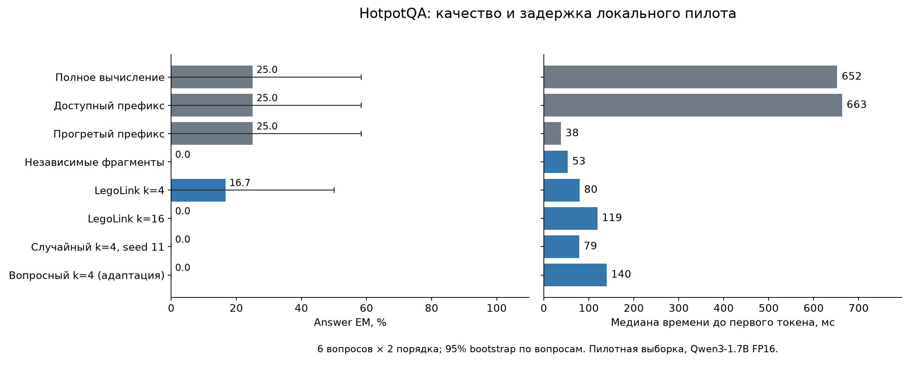

# Качество и эффективность повторного использования KV-кэша LLM

Исследование влияния междокументных зависимостей на качество ответов и стоимость частичного пересчёта KV-состояний. Бакалаврская работа, МФТИ, ФРКТ.

Стенд сравнивает полный проход модели, точное префиксное кэширование и повторное использование независимо подготовленных документов. Частичный пересчёт реализован по принципу LegoLink; дополнительно используются случайный выбор позиций и вопросный критерий.

## Материалы

- [Текст исследования](thesis/thesis.md): постановка, связанные работы, методика, реализация и выводы.
- [Экспериментальный отчёт](research/pilot/REPORT.md): таблицы качества и затрат, парные ошибки, память и окупаемость.
- [Стенд и воспроизведение](research/pilot/README.md): устройство кэша, режимы и команды запуска.
- [Численная калибровка](research/pilot/calibration-decision.md): выбор допуска до проверочной части.
- [Исходные результаты](research/pilot/results/summary.csv), [входные примеры](research/pilot/data/examples.jsonl) и [происхождение данных](research/pilot/data/manifest.json).

## Результаты первого эксперимента

Модель — Qwen3-1.7B, FP16; backend — MLX. Оборудование — Apple M4 Pro с 24 GiB общей памяти. Эксперимент выполнен 07.11.2026. Калибровочная часть содержит 8 запросов, проверочная — 20. Два порядка документов одного вопроса учитываются как связанные наблюдения.

| Проверочная часть | Полный проход | Независимые фрагменты | LegoLink, k=4 | LegoLink, k=16 |
|---|---:|---:|---:|---:|
| Контролируемые задачи | 7/8 | 2/8 | 5/8 | 7/8 |
| HotpotQA | 3/12 | 0/12 | 2/12 | 0/12 |

Показан answer Exact Match. Точный префикс и пересчёт всех строк дали те же последовательности токенов ответа, что полный проход, во всех 20 проверочных запросах. Для остальных методов сохранены парные потери и приобретения правильных ответов, token F1, задержка и фактический объём вычислений.

На HotpotQA полный проход в этой выборке уступил режиму без документов: 3/12 против 4/12. Поэтому естественная часть пока ограничивает выводы о сохранении полезного контекста. На контролируемых задачах одинаковое среднее качество full и LegoLink k=16 сопровождалось потерей одного правильного ответа и исправлением другого. Общая зависимость качества от числа связей и полезное ускорение при сохранении качества по малой выборке не установлены.



## Проверка опубликованных результатов

Агрегаты и график восстанавливаются из сохранённых построчных результатов. Для этого загрузка весов и запуск GPU не требуются:

```bash
python3 -m venv .venv
source .venv/bin/activate
python -m pip install -r research/pilot/requirements-analysis.txt
python research/pilot/bootstrap.py --evaluator-only
python research/pilot/analyze.py
python research/pilot/verify.py
```

Проверка сопоставляет все 240 ответов проверочной части с официальным scorer HotpotQA, контролирует хэши кода и данных, бюджеты вычислений и итоговые таблицы. Официальный scorer загружается по закреплённому commit; его SHA256 проверяется перед использованием.

Полный повтор инференса выполняется на Apple Silicon по [инструкции стенда](research/pilot/README.md). Все входные token IDs, версии и параметры сохранены. Задержки относятся к указанному оборудованию и измерительному протоколу.

## Источники и условия использования

Методика опирается на [EPIC/LegoLink](https://proceedings.mlr.press/v267/hu25j.html), [CacheBlend](https://arxiv.org/abs/2405.16444v3) и [ProphetKV](https://arxiv.org/abs/2602.02579v3). Реализация на MLX и вопросный критерий имеют описанные в отчёте отличия от авторских систем.

Естественные примеры получены из [HotpotQA](https://hotpotqa.github.io/). Атрибуция, преобразования выборки и лицензии сторонних материалов приведены в [NOTICE.md](NOTICE.md). Версии и хэши источников — в [manifest](research/pilot/sources/manifest.json).
