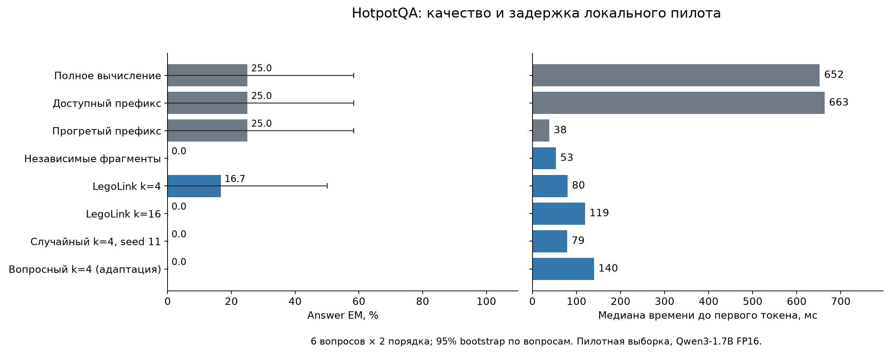

# Первый пилот повторного использования KV-кэша

07.11.2026. Результаты собственного запуска; фиксированная модель, один backend. Статус: технический пилот завершён, выводы о научной новизне и устойчивой зависимости остаются открытыми.

## Главный результат

На проверочной части полное вычисление дало 10/20 точных ответов. LegoLink k=4 — 7/20, k=16 — 7/20. Численные проверки префикса и пересчёта всех строк пройдены в допуске, закреплённом после калибровки. Подробности совпадения готовых ответов приведены ниже.

На HotpotQA полный эталон решил 3/12 запросов, режим без документов — 4/12. В этой части нет случаев, где full верен, а режим без документов ошибочен (0/12). Текущая малая естественная выборка не демонстрирует полезность контекста и требует проверки модели/входного режима. На синтетических данных full решил 7/8, без документов — 0/8; эта часть подходит для продолжения проверки механизма.

На синтетической части LegoLink k=16 сохранил средний EM 7/8, потеряв один из семи правильных ответов full и исправив другой ответ. Это наблюдение подтверждает необходимость парной оценки потерь и приобретений; монотонная связь качества с k или числом связей из пилота не установлена.

## Данные и протокол

20 проверочных запросов: 8 синтетических по двум независимым мирам и 12 HotpotQA по шести вопросам в двух порядках документов. Отдельные 8 калибровочных запросов в таблицы проверки не входят. HotpotQA: все десять документов сохранены, ограничение 2048 токенов применяется при отборе примеров; обрезания текста и отбора по ответам модели нет. Документы повторяются при изменении порядка. Точный префикс берётся из завершённых предыдущих запросов; отдельно измерен полностью прогретый префикс.

Оценка EM/F1 соответствует answer scorer HotpotQA. Строгий EM учитывает также соблюдение формата короткого ответа: содержательный ответ с пояснением может получить EM=0. Сырые ответы сохранены. Генерация жадная, thinking=False, предел 48 новых токенов. TTFT — медиана трёх завершённых prefill, затем в таблице медиана по запросам. Полная генерация выполнена один раз на режим и запрос.

## HotpotQA: 12 запросов, 6 независимых вопросов

| Метод | EM | F1 | Потеря / верных full | Новых верных | TTFT, мс | Layer-tokens* |
|---|---|---|---|---|---|---|
| Полное вычисление | 3/12 (25.0%) | 25.8% | 0/3 | 0 | 652.2 | 40437 |
| Без документов | 4/12 (33.3%) | 34.8% | 0/3 | 1 | 38.6 | 1451 |
| Доступный префикс | 3/12 (25.0%) | 25.8% | 0/3 | 0 | 663.3 | 39790 |
| Прогретый префикс | 3/12 (25.0%) | 25.8% | 0/3 | 0 | 38.1 | 891 |
| Пересчёт всех строк | 3/12 (25.0%) | 25.8% | 0/3 | 0 | 728.5 | 39877 |
| Независимые фрагменты | 0/12 (0.0%) | 11.7% | 3/3 | 0 | 53.2 | 891 |
| LegoLink k=4 | 2/12 (16.7%) | 19.0% | 1/3 | 0 | 79.6 | 2011 |
| LegoLink k=16 | 0/12 (0.0%) | 2.4% | 3/3 | 0 | 119.3 | 5371 |
| Случайный k=4, seed 11 | 0/12 (0.0%) | 11.7% | 3/3 | 0 | 78.7 | 2011 |
| Случайный k=4, seed 29 | 0/12 (0.0%) | 12.2% | 3/3 | 0 | 79.1 | 2011 |
| Случайный k=4, seed 47 | 0/12 (0.0%) | 12.4% | 3/3 | 0 | 79.4 | 2011 |
| Вопросный k=4 (адаптация) | 0/12 (0.0%) | 14.6% | 3/3 | 0 | 139.6 | 2903 |

*Layer-tokens включает новый суффикс и проход вопросного выбора; дополнительные операции вычисления attention scores отражены также в измеренном времени.

## Контролируемые задачи: 8 запросов, 2 независимых мира

| Метод | EM | F1 | Потеря / верных full | Новых верных | TTFT, мс | Layer-tokens* |
|---|---|---|---|---|---|---|
| Полное вычисление | 7/8 (87.5%) | 87.5% | 0/7 | 0 | 216.1 | 13062 |
| Без документов | 0/8 (0.0%) | 0.0% | 7/7 | 0 | 37.1 | 1316 |
| Доступный префикс | 7/8 (87.5%) | 87.5% | 0/7 | 0 | 115.6 | 6584 |
| Прогретый префикс | 7/8 (87.5%) | 87.5% | 0/7 | 0 | 32.8 | 756 |
| Пересчёт всех строк | 7/8 (87.5%) | 87.5% | 0/7 | 0 | 213.3 | 12502 |
| Независимые фрагменты | 2/8 (25.0%) | 58.3% | 5/7 | 0 | 42.7 | 756 |
| LegoLink k=4 | 5/8 (62.5%) | 62.5% | 2/7 | 0 | 48.6 | 1204 |
| LegoLink k=16 | 7/8 (87.5%) | 87.5% | 1/7 | 1 | 69.1 | 2548 |
| Случайный k=4, seed 11 | 2/8 (25.0%) | 58.3% | 5/7 | 0 | 48.4 | 1204 |
| Случайный k=4, seed 29 | 2/8 (25.0%) | 58.3% | 5/7 | 0 | 48.4 | 1204 |
| Случайный k=4, seed 47 | 2/8 (25.0%) | 58.3% | 5/7 | 0 | 48.4 | 1204 |
| Вопросный k=4 (адаптация) | 5/8 (62.5%) | 62.5% | 2/7 | 0 | 92.6 | 1960 |

*Layer-tokens включает новый суффикс и проход вопросного выбора; дополнительные операции вычисления attention scores отражены также в измеренном времени.

Интервалы неопределённости сохранены в summary.json: percentile bootstrap по общим вопросам/мирам, 2000 повторов. Шесть и два независимых кластера дают нестабильные интервалы; доказательств превосходства или общей гарантии сохранения качества из этого пилота не следует.

## Зависимость от числа связей и границ

| Задача | full | independent | LegoLink 4 | LegoLink 16 | random seed11 | query4 |
|---|---|---|---|---|---|---|
| 1-cross | 2/2 | 0/2 | 2/2 | 2/2 | 0/2 | 2/2 |
| 2-cross | 1/2 | 0/2 | 0/2 | 2/2 | 0/2 | 0/2 |
| 3-cross | 2/2 | 2/2 | 2/2 | 2/2 | 2/2 | 2/2 |
| 3-within | 2/2 | 0/2 | 1/2 | 1/2 | 0/2 | 1/2 |

Каждая строка содержит два запроса. Связь между hops и необходимым бюджетом ещё не установлена. Вариант within меняет группировку и порядок фактов и названия фрагментов; чистый эффект границ требует дополнительного контроля этих факторов.

## Численная корректность

Максимальные отличия логитов: prefix max=0.250000, RMS=0.029903; all-repair max=0.203125, RMS=0.033829. Допуск и его калибровка — в calibration-decision.md.

- Доступный префикс: полная последовательность сгенерированных token IDs совпала с full в 20/20 запросах.
- Прогретый префикс: полная последовательность сгенерированных token IDs совпала с full в 20/20 запросах.
- Пересчёт всех строк: полная последовательность сгенерированных token IDs совпала с full в 20/20 запросах.

Шесть тестов на маленькой детерминированной FP32-модели проверяют строгую численную эквивалентность, RoPE, причинность, бюджет, сохранность пула и scorer. На настоящих весах проверены все 20 запросов. Точная префиксная семантика допускает малые вычислительные расхождения FP16 при разных формах матриц.

## Затраты и окупаемость

Подготовка уникального независимого пула: 6.308 с, 1.074 GiB логических K/V. Первый проход точного префикса с подготовкой общей инструкции: 8.572 с; повторный прогретый проход: 0.737 с. Это суммы TTFT по 20 запросам, без декодирования.

| Метод | Первый цикл с подготовкой, с | Онлайн-цикл, с | Выгодные циклы среди 1…1000* |
|---|---|---|---|
| Независимые фрагменты | 7.289 | 0.981 | 1…6 |
| LegoLink k=4 | 7.644 | 1.337 | 1…2 |
| LegoLink k=16 | 8.347 | 2.040 | 1…1 |
| Случайный k=4, seed 11 | 7.639 | 1.332 | 1…2 |
| Случайный k=4, seed 29 | 7.661 | 1.353 | 1…2 |
| Случайный k=4, seed 47 | 7.641 | 1.333 | 1…2 |
| Вопросный k=4 (адаптация) | 8.726 | 2.418 | нет |

*Сценарий повторения фиксированной проверочной последовательности: независимый пул готовится один раз; префикс на первом цикле использует только предыдущие запросы, на последующих сохраняет все префиксы документов. Формула: T_ind_prepare + r×T_ind_online < T_prefix_first + (r−1)×T_prefix_warm. Нельзя переносить её на нагрузку с новыми сочетаниями документов без нового измерения. Скорость рассматривается совместно с таблицей качества: более быстрый ошибочный режим не означает сохранения качества.

Максимум активных аллокаций MLX в измерениях: 8.643 GiB. Он включает веса и удерживаемые для сравнения пулы. Отдельные значения, приросты, allocator cache и RSS сохранены построчно. Логические байты K/V не включают padding аллокатора и рабочие копии.

## Границы переноса публичных методов

В стенде реализован принцип LegoLink из EPIC §4.2: фиксированный общий префикс подготовлен точно, независимые документы начинаются с позиции 0, первые k строк документов и весь вопрос проходят все слои. Использованы Qwen3 и MLX, один запрос, плотная сборка K/V, без планировщика и CUDA-ядер авторской системы. Это перенос принципа алгоритма; опубликованные ускорения EPIC не воспроизводились.

query4 использует идею ProphetKV §4.2–4.3: проход вопроса по приближённому кэшу и усреднение attention по слоям. Отличия: фиксированная квота четыре строки на документ, весь шаблонный суффикс вместо выделения только слов вопроса, отдельное явное вычисление attention scores. Два прохода и все затраты отбора учтены. Это адаптированный критерий; превосходство над полной опубликованной реализацией не проверялось.

## Решение и следующий основной эксперимент

Локальный стенд пригоден для продолжения: есть полный эталон, известный набор, независимые фрагменты и реальный частичный пересчёт. Первый следующий результат — пригодный полный эталон на новой калибровочной выборке HotpotQA: проверить точное понимание вопросов, шаблон, режим генерации и при необходимости модель. Текущие проверочные примеры уже просмотрены, для новой итоговой оценки используются другие группы. Далее — расширенное парное сравнение по числу связей и границам при контроле длины, порядка и положения ответа. До окончательной проверки выбирается допустимая потеря качества; бюджеты k калибруются на отдельных мирах. Пилотные 20 запросов не следует использовать как новую закрытую проверку после подбора параметров. Расширение эксперимента требует новых независимых групп и заранее выбранного допуска потери качества.

## Источники и воспроизведение

- [Команды и механизм](README.md), [конфигурация](config.json), [версии](requirements.lock.txt).
- [Входы](data/examples.jsonl), [происхождение данных](data/manifest.json), [источники и хэши](sources/manifest.json).
- [Построчные результаты](results/test/rows.jsonl), [численные проверки](results/test/checks.jsonl), [подготовка](results/test/preparation.json), [агрегаты CSV](results/summary.csv), [все агрегаты JSON](results/summary.json).
- [EPIC](https://proceedings.mlr.press/v267/hu25j.html), [ProphetKV, §4](https://arxiv.org/html/2602.02579v3#S4), [HotpotQA](https://hotpotqa.github.io/), [Qwen3](https://huggingface.co/Qwen/Qwen3-1.7B).
